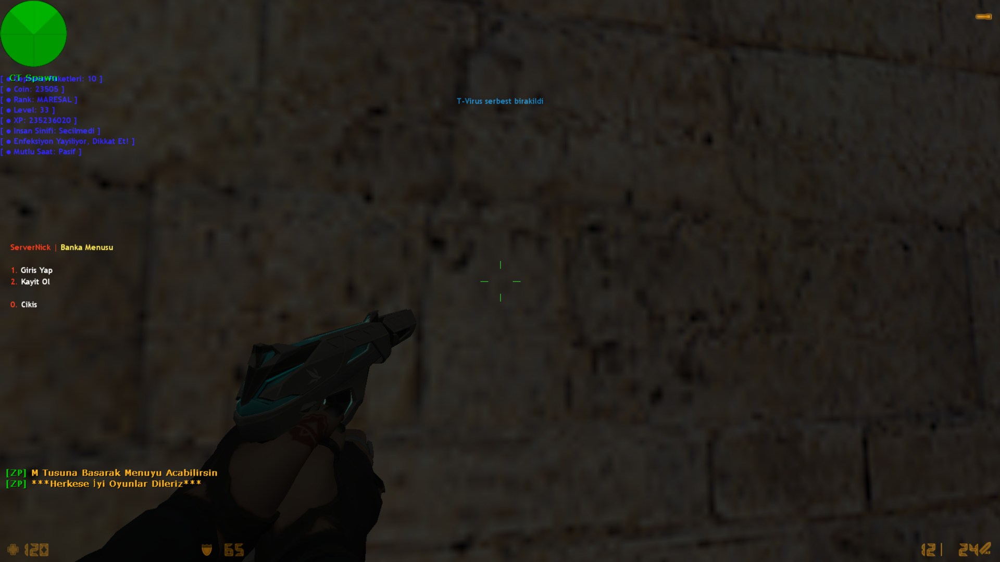
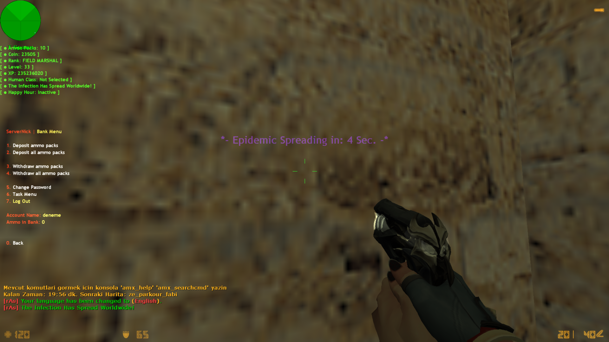

# Zombie Plague Banka Sistemi (AMX Mod X)

## 🇰🇷 한국어

안녕하세요, 사랑하는 한국 친구들! 💚

먼저 한국의 모든 게이머와 커뮤니티 여러분께 진심 어린 사랑과 존경의 인사를 전하고 싶습니다. 여러분의 열정과 실력은 언제나 저희에게 큰 영감을 줍니다. 이 작은 플러그인이 여러분의 게임 경험에 조금이나마 도움이 되기를 바라는 마음으로 만들었습니다. 항상 응원합니다, 사랑해요 한국! 🇰🇷❤️

### 플러그인 소개

**Zombie Plague 은행 시스템**은 Counter-Strike 1.6 (AMX Mod X, ReAPI + Zombie Plague 필요) 서버를 위한 탄약 팩(Ammo Pack) 은행 및 계정 시스템입니다. 플레이어는 개인 계정을 만들어 탄약 팩을 안전하게 은행에 보관하고, 재접속 시에도 잃어버리지 않고 그대로 이어갈 수 있습니다.

**주요 기능**
- `/banka` 또는 `.banka` 명령어로 은행 메뉴 열기
- 계정 생성(회원가입) / 로그인 / 로그아웃
- 비밀번호 설정 및 변경
- 탄약 팩 입금 (일부 입금 / 전액 입금)
- 탄약 팩 출금 (일부 출금 / 전액 출금)
- 접속 종료 시 소지 중인 탄약 팩 자동 은행 입금
- SteamID 기반 자동 로그인 (nVault 사용) — 재접속 시 계정 자동 인증
- 파일 기반 계정 저장소 (`hesaplar.ini`) — nVault와 이중 백업
- `/gorev` 명령어로 임무(Task) 메뉴 — 플레이 시간, 좀비 감염, 탄약 소비, 라운드 참여, 입금액 등 다양한 목표 달성 시 탄약 팩 보상 지급
- 다국어 지원: 영어(EN), 터키어(TR), 한국어(KO) — 플레이어의 게임 언어에 따라 자동 전환

### 설치 방법
1. `addons/amxmodx/scripting/reapi_zpbanka.sma` 및 컴파일된 `.amxx` 파일을 서버에 업로드하세요.
2. `addons/amxmodx/data/lang/reapi_zpbanka.txt` 언어 파일을 함께 업로드하세요.
3. `plugins.ini` 파일에 플러그인을 추가하세요.
4. `ReAPI`와 `Zombie Plague` 모듈/플러그인이 서버에 설치되어 있는지 확인하세요.
5. 서버를 재시작하거나 플러그인을 다시 로드하세요. (`addons/amxmodx/configs/zp_bank/` 폴더가 자동으로 생성됩니다.)

---

## 🇹🇷 Türkçe

### Eklenti Hakkında

**Zombie Plague Banka Sistemi**, Counter-Strike 1.6 (AMX Mod X, ReAPI + Zombie Plague gerektirir) sunucuları için geliştirilmiş bir cephane paketi (Ammo Pack) banka ve hesap sistemidir. Oyuncular kişisel bir hesap oluşturarak cephane paketlerini güvenle bankaya yatırabilir ve sunucudan ayrılıp tekrar bağlansalar bile birikimlerini kaybetmeden devam edebilirler.

**Özellikler**
- `/banka` veya `.banka` yazarak banka menüsünü açma
- Hesap oluşturma (kayıt) / Giriş yapma / Çıkış yapma
- Şifre belirleme ve şifre değiştirme
- Cephane paketi yatırma (miktar belirleyerek / tamamını yatırma)
- Cephane paketi çekme (miktar belirleyerek / tamamını çekme)
- Sunucudan ayrılırken üzerinde kalan cephane paketleri otomatik olarak bankaya aktarılır
- SteamID'ye bağlı otomatik giriş (nVault kullanılarak) — tekrar bağlanınca hesap otomatik doğrulanır
- Dosya tabanlı hesap kaydı (`hesaplar.ini`) — nVault ile birlikte çift yedekleme
- `/gorev` komutuyla Görev Menüsü — oyun süresi, zombi olma, cephane harcama, round tamamlama, bankaya yatırma gibi hedefleri tamamlayınca cephane paketi ödülü kazanma
- Çoklu dil desteği: İngilizce (EN), Türkçe (TR), Korece (KO) — oyuncunun oyun dili ayarına göre otomatik değişir

### Kurulum
1. `addons/amxmodx/scripting/reapi_zpbanka.sma` ve derlenmiş `.amxx` dosyasını sunucuya yükleyin.
2. `addons/amxmodx/data/lang/reapi_zpbanka.txt` dil dosyasını da yükleyin.
3. `plugins.ini` dosyasına eklentiyi ekleyin.
4. Sunucunuzda **ReAPI** ve **Zombie Plague** modüllerinin/eklentilerinin kurulu olduğundan emin olun.
5. Sunucuyu yeniden başlatın veya eklentiyi reload edin. (`addons/amxmodx/configs/zp_bank/` klasörü otomatik olarak oluşturulacaktır.)

### Ekran Görüntüleri

---

*Made with ❤️ by Merhabalarr*
